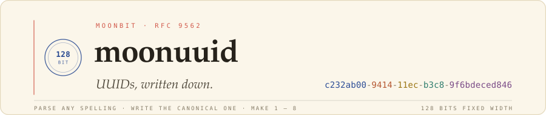

<picture>
  <source media="(prefers-color-scheme: dark)" srcset=".github/assets/header-dark.svg">
  
</picture>

**[Home](https://moonbitstack.github.io/moonuuid/)** ·
[Guide](https://moonbitstack.github.io/moonuuid/guide.html) ·
[API](https://moonbitstack.github.io/moonuuid/api.html) ·
[Anatomy](https://moonbitstack.github.io/moonuuid/showcase.html) ·
[mooncakes](https://mooncakes.io/docs/moonbitstack/moonuuid)

UUIDs for MoonBit. Read any spelling in use, write the canonical one, and make ids from a name, from a clock, or from random bytes. Time and randomness come in as functions you pass, so the same code runs on every backend and in every test.

```moonbit
let id = @moonuuid.parse("{C232AB00-9414-11EC-B3C8-9F6BDECED846}")
id.to_string()   // "c232ab00-9414-11ec-b3c8-9f6bdeced846"
id.version()     // Some(1)
id.node()        // 175285648414790
```

## Install

```bash
moon add moonbitstack/moonuuid
moon add moonbitstack/moonrand   # the random source a generator draws from
```

## The versions

| Version | Made from | Function | Sorts by time |
|:--:|:--|:--|:--:|
| 1 | timestamp, clock sequence, node | `v1(ticks~, clock_seq~, node~)` · `gen.v1(node~)` | |
| 3 | MD5 of a namespace and a name | `v3(space, name)` | |
| 4 | 122 random bits | `v4(random)` · `gen.v4()` | |
| 5 | SHA-1 of a namespace and a name | `v5(space, name)` | |
| 6 | version 1's fields, high time bits first | `v6(ticks~, clock_seq~, node~)` · `gen.v6(node~)` | ✓ |
| 7 | Unix milliseconds, a counter and random bits | `v7(millis~, random)` · `gen.v7()` | ✓ |
| 8 | 122 bits of your own layout | `v8(custom)` | |

Those are the seven versions RFC 9562 defines. Version 2 is reserved for DCE security and is not generated.

`ticks_of(unix_nanos)` turns nanoseconds since 1970 into the 100-nanosecond intervals since 1582 that versions 1 and 6 count. The namespaces are `namespace_dns`, `namespace_url`, `namespace_oid` and `namespace_x500`; `nil` and `max` are all zeros and all ones.

## Quick start

```moonbit
// Name-based ids are the same every time.
let page = @moonuuid.v5(@moonuuid.namespace_url, "https://example.org/")

// Time-ordered ids from a generator over your clock and randomness.
let gen = @moonuuid.Generator::new(
  clock=() => now_in_nanoseconds(),
  random=@system.source,
)
let row = gen.v7()   // sorts in the order made, even within one millisecond
```

## Reading and writing

`parse` takes the canonical form, any case, with or without hyphens, in braces, or after `urn:uuid:`:

```moonbit
@moonuuid.parse("6ba7b8109dad11d180b400c04fd430c8")
@moonuuid.parse("urn:uuid:6ba7b810-9dad-11d1-80b4-00c04fd430c8")
```

| Write | Gives |
|:--|:--|
| `id.to_string()` | `6ba7b810-9dad-11d1-80b4-00c04fd430c8` |
| `id.hex()` | `6ba7b8109dad11d180b400c04fd430c8` |
| `id.urn()` | `urn:uuid:6ba7b810-9dad-11d1-80b4-00c04fd430c8` |
| `id.bytes()` | the 16 bytes, most significant first |
| `Json(id)` | the canonical text; `@json.from_json` reads any spelling back |

`Uuid::of_bytes` and `Uuid::of_parts(hi, lo)` build one from 16 bytes or two 64-bit halves. Identifiers compare, hash and sort by their bytes.

## Fields

| Method | Returns |
|:--|:--|
| `variant()` | `Ncs`, `Rfc`, `Microsoft` or `Future` |
| `version()` | the version for an RFC 9562 id, else `None` |
| `time()` | 100-ns ticks since 1582 for versions 1 and 6, milliseconds since 1970 for version 7 |
| `clock_seq()` | the 14-bit clock sequence |
| `node()` | the 48-bit node |

## The generator

`Generator::new(clock~, random~)` keeps what the time-based versions need between calls. `clock` gives nanoseconds since 1970 and `random` is a moonrand `Source`: `@system.source` from `moonbitstack/moonrand/system` in a program, a `Replay` of fixed bytes in a test. A source that cannot give what an id needs is `Refused::Random`.

- Version 1 and 6 timestamps never repeat or go back; the clock sequence is random unless you pass one.
- Version 7 ids made within one millisecond count up with a fresh random tail. If the clock steps back, the next id uses the millisecond after the last one, so the order holds.

## Errors

| `Refused` | When |
|:--|:--|
| `Malformed(at~, reason~)` | text that is not 32 hexadecimal digits; `at` is where it went wrong |
| `Size(want~, got~)` | bytes of the wrong length |
| `Random(why)` | the generator's random source could not give what an id needs |

## Runnable examples

Two programs in the repository: `moon run src/examples/01-ids` stands in a clock and a random source, and `moon run src/examples/02-tour` prints one line per feature.

## Licence

Apache-2.0. See [LICENSE](LICENSE).
